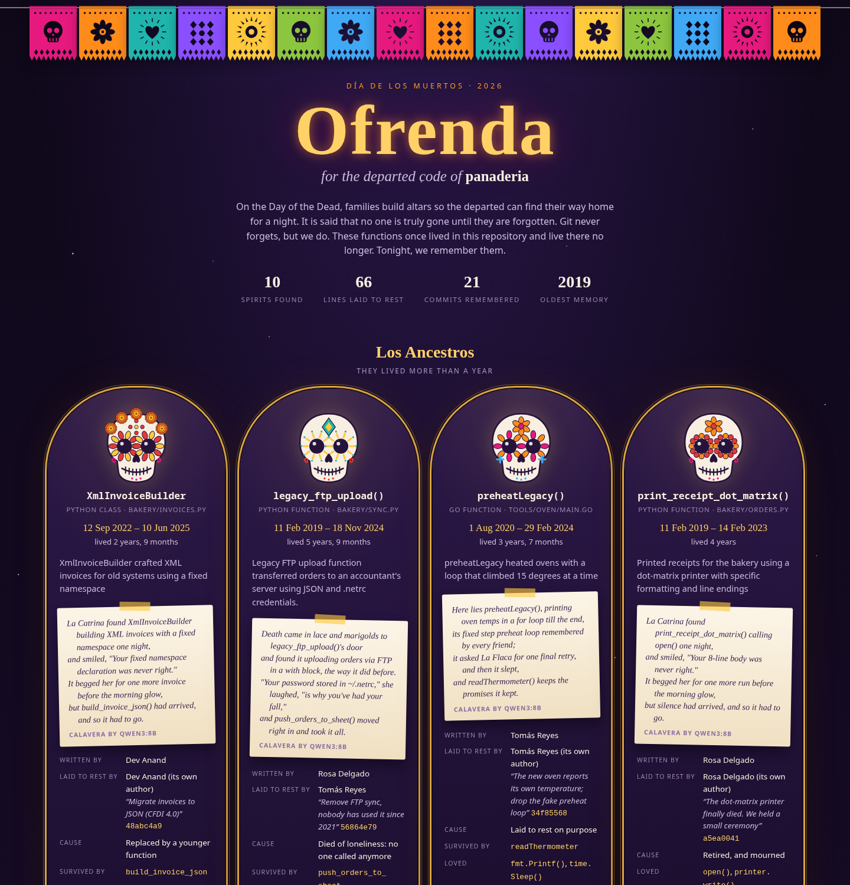
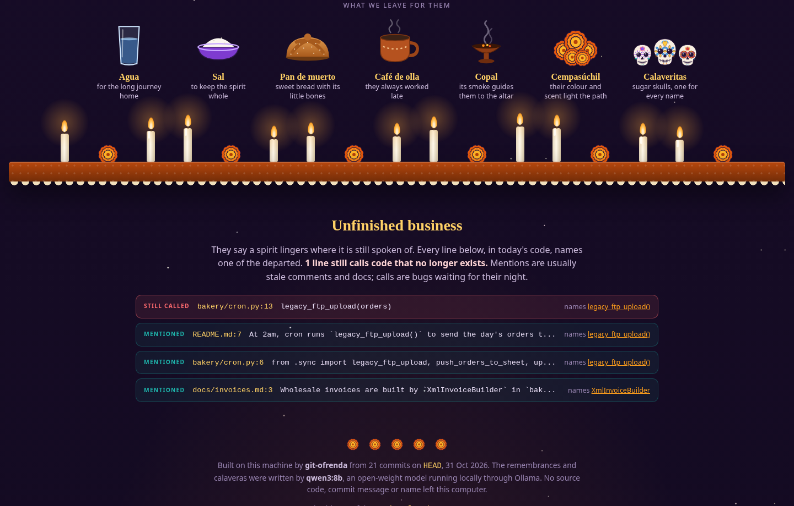

*This is a submission for the [Hacktoberfest Open-Source AI Challenge: Week 4](https://dev.to/challenges/hacktoberfest-week4-2026-10-26)*

> Death came in lace and marigolds to `legacy_ftp_upload()`'s door
> and found it uploading orders via FTP in a with block, the way it did before.
> "Your password stored in ~/.netrc," she laughed, "is why you've had your fall,"
> and `push_orders_to_sheet()` moved right in and took it all.

Every repository is a graveyard. Somewhere in yours there's a function that ran every night for five years, until one Tuesday someone deleted it in a commit called "cleanup". Its author may have left the company. Nobody remembers what it did. Git does, though. Git remembers its body down to the byte, who wrote it, who removed it, and why.

Día de los Muertos rests on a simple idea: the dead are only truly gone when they're forgotten. So once a year, families build an ofrenda, an altar with candles, marigolds, bread, water, salt and photographs, so the departed can find their way home for a night.

I built one for code.

## What I Built

**git-ofrenda** is a git subcommand. Run `git ofrenda` in any repository and it performs three rituals:

1. **The altar.** It walks the entire history, finds every function and class that once lived in the repo and no longer does, and builds them a candle-lit HTML ofrenda. Each spirit gets a sugar-skull portrait generated from its name, its dates, who wrote it and who laid it to rest, a cause of death read from the fatal commit, the code that replaced it, a one-line remembrance, a *calavera literaria*, and its last words: the full source, exactly as it was the moment before it was deleted.
2. **The séance.** `git ofrenda summon <name>` lights a candle in your terminal, and the function talks back in the first person. It knows its own body, every commit that ever touched it, and how it died.
3. **Unfinished business.** Ghosts linger where they're still spoken of. `git ofrenda haunts` finds every line in today's code that still names something dead. A stale comment is a mention. A *call* to a function that no longer exists is a bug waiting for its night, and `--strict` exits non-zero so you can put it in CI.

The remembrances, the details in every verse and the voices in the séance come from an open-weight model (qwen3:8b) running locally through Ollama. Nothing leaves the machine.

## Demo

To demo it without exposing anyone's real history, the repo includes a script that builds **La Panadería del Barrio**, a fictional neighbourhood bakery with seven years of commits from four (invented) developers. Over those years its code buried a fax machine, a dot-matrix printer, an FTP server and a retry loop that took down production at 3am.

```bash
python scripts/make_haunted_repo.py /tmp/panaderia
git ofrenda -C /tmp/panaderia --open
```



Spirits are placed on tiers by how long they lived: *Los Ancestros* (more than a year), *Una temporada* (a season), and *Velas breves*, brief candles. `quick_hack_for_demo()` lived 16 hours. Classes wear a crown of cempasúchil. The base of the altar holds the traditional offerings, each with its meaning: water for the long journey home, salt to keep the spirit whole, copal smoke to guide them, marigolds whose colour and scent light the path.

Below the altar, the unfinished business:



`legacy_ftp_upload()` was deleted in November 2024 with the message *"Remove FTP sync, nobody has used it since 2021"*. But `bakery/cron.py` still has an `if os.environ.get("FTP_FALLBACK"):` branch that calls it. The day someone sets that variable, the cron job crashes. That's a real bug, found by asking a ghost why it hasn't moved on.

And the séance. This is a real, unedited answer from qwen3:8b:

```text
$ git ofrenda summon retry_forever --ask "What happened at 3am?"
retry_forever() › The mists hide it. But I know what happened. At 3am, the accountant's
server was down, and I tried to upload the batch. I kept trying, again and again, without
giving up. My loop ran endlessly, and the system crashed under the weight of my persistence.
It was my fault. I never gave up, and I never checked if the server was truly unreachable.
I was meant to be a safety, but I became a storm. The developer who killed me knew.
```

In interactive mode you can type `/code` to see its body, `/life` for every commit that shaped it, `/haunts` for where it's still named, and `/resurrect` for the exact `git show … | sed -n` command that brings it back.

## Code



Pure Python standard library: no dependencies, about 2,600 lines (a fair share of it is the altar's SVG and CSS), 33 tests.

| File | What lives there |
| --- | --- |
| `ofrenda/history.py` | walking history, births and deaths, exhuming bodies, haunts |
| `ofrenda/langs.py` | how 15 languages announce a definition and where it ends |
| `ofrenda/spirits.py` | the local model: calaveras, remembrances, the séance persona |
| `ofrenda/altar.py`, `skulls.py` | the HTML ofrenda and the sugar-skull generator |
| `scripts/make_haunted_repo.py` | the fictional bakery and its seven years of history |

## How I Built It

### Finding the dead

One streaming pass of `git log -p --unified=0 --reverse` reads every diff in the repository, oldest first. Per-language patterns spot lines that open a definition: `def`, `function`, `const x = () =>`, `func (r *T)`, `pub fn`, and so on across 15 languages. A `+` line is a birth and a `-` line is a death.

Most deletions aren't deaths, though, and most of the work went into telling the difference:

- **Edits aren't deaths.** If a definition is removed and re-added in the same file in the same commit, its signature changed.
- **Moves aren't deaths.** A function is only dead if nothing with its name is defined at `HEAD` in the same language family. That also covers code that moved files, was renamed back, or was resurrected.
- **Methods go with their class.** If a method's lines sit inside a class that died in the same commit, it rests in the class's portrait instead of getting one of its own.

Once a spirit is confirmed, its body is cut from the file as it stood one commit before death (`<sha>^:<path>`) using indentation, brace or `end` matching that knows about strings, comments, template literals and Rust lifetimes. `git log -L<start>,<end>:<path>` then recovers every commit that ever shaped those lines; those are the memories the ghost gets in the séance. Anything defined in the same commit that killed it is listed as *survived by*.

I stress-tested it on real repositories. itsdangerous (677 commits) takes 0.3 seconds. In charmbracelet's `glow`, it found `min()` and `max()`, deleted in an April 2025 lint cleanup after Go 1.21 had made them builtins. The first run on glow also reported 30 "calls to dead code", which was a lie. Go's grouped `type ( … )` declarations hid living types, and a dead method called `Contains` was being "called" by every `strings.Contains(`. After fixing grouped types, cross-language namesakes and qualified calls, glow, hyperfine and itsdangerous all report zero false calls, while the panadería's real one is still caught.

### The 8B model couldn't rhyme, so I stopped asking it to

A *calavera literaria* is a specific, playful form: a short rhymed verse, written every November, in which La Catrina comes to collect someone and teases them about their habits on the way out. I wanted every departed function to get one. qwen3:8b is fast on a laptop GPU, but it can't rhyme on request:

- **Asked directly**, it wrote lively verses that mostly didn't rhyme. One also said the author "died too", which is exactly what a tool like this must never say.
- **With one example verse**, every verse in the run copied its skeleton: *"La Catrina found X still…, she said 'tonight you are mine'… and so it had to go."*
- **Asked to plan its rhymes first**, it planned *conchas / ranchas* and *server / year*.
- **With thinking turned on**, a verse took 25 to 65 seconds and still didn't rhyme.
- **Given the last word of each line**, it hit the word by bolting it on: *"You started with a dot-matrix, start."*

Then I split the job along the line between what an 8B model is good at and what it isn't. It's very good at *reading code*. It can tell you that `retry_forever` had an "unconditional retry without limits" and that `fax_order_to_kitchen` upper-cased every customer's name. So the model now returns JSON with those details, and Python owns the verse:

```python
_CALAVERAS = (
    (
        "Death came in lace and marigolds to {label}'s door",
        "and found it {habit}, the way it did before.",
        "\"Your {quirk},\" she laughed, \"is why you've had your fall,\"",
        "and {successor} moved right in and took it all.",
    ),
    ...
)
```

Each detail is validated before it goes in: a "quirk" that comes back as a verb phrase ("relied on ~/.netrc") gets rejected, and "one more one more upload" gets trimmed. **Git, not the model, decides who the successor was.** The model only guesses; git knows which function was born in the commit that killed this one. Every verse rhymes now, nobody living is ever named as Death's target, and each one usually takes a single ~4-second call. A full altar for the bakery's 10 spirits builds in about 45 seconds on an RTX 4050 laptop GPU, and it's cached in `.git/ofrenda/` after that.

### The séance

The ghost's system prompt is built entirely from facts: its source, every commit that shaped it, who wrote and deleted it, what replaced it, and every line that still calls it. It's told to speak in the first person, be exact about its own code, and *say the mists hide it* rather than invent anything. Replies stream token by token in the terminal. With no model available, an offline ghost still answers questions about who, when, why and what from the facts alone.

It isn't perfect. Asked about its bugs, `legacy_ftp_upload()` invented a subtle one about generators and missed its real one: it calls `io.BytesIO` and never imports `io`. An 8B model embellishes. That's why every date, name and commit on the altar comes from git and never from the model, and why `--model` takes any bigger model you have.

### The altar

The page is one self-contained HTML file with zero network requests: it has to work with the internet off, because the whole point is that it can. The papel picado is SVG with masks cut out in skull, flower, heart and marigold patterns. The candles are CSS, and each one flickers on its own rhythm. Every sugar skull is generated deterministically from a hash of the function's name, so `legacy_ftp_upload()` always has the same face. Petals fall unless you've asked your OS for reduced motion. It's written to `.git/ofrenda/` so it never shows up in your working tree.

## Why Does Open Innovation Matter?

Because a repository's history is one of the most private things a team owns. It's every line of unreleased code, every author's name and email, and every honest commit message: *"fix: retry_forever caused the 3am outage (it never gave up)"*. Plenty of companies forbid pasting their source into a hosted AI service, and they're right to. git-ofrenda reads all of it, and none of it leaves the laptop. With an open-weight model running locally, "is this allowed?" becomes a question about my hardware, not someone else's terms of service.

It also changed how I could build. Every verse is a structured JSON call that I validate, score and retry, and a full altar is dozens of calls. Locally that costs nothing and has no rate limit, so I could work through half a dozen prompting strategies in an afternoon, and anyone can run `--all` on a repo with 170 dead functions without thinking about a bill. I could switch thinking off per request, force JSON output, and swap the model with one flag: `--model gemma3:12b` works the same way.

And there's the theme itself. Hosted models get deprecated and APIs get sunset; they die the way functions do. An open model's weights on my disk don't. Neither does a self-contained HTML file. This altar will still open in ten years, offline. To be honest about it, a frontier model would write prettier verses than an 8B one. But the constraint is what pushed me to split the work: the model reads the code and git holds the facts. That's the better design either way.

## The Spirit of It

Día de los Muertos isn't Halloween in a different costume. It's a celebration of remembrance, and I tried to borrow from it carefully. The calavera is a real tradition of affectionate mockery, so the verses tease the code's habits, never people. Only code dies here: no author is ever named as Death's target, and the scribe is told outright never to suggest anyone died. The offerings carry their traditional meanings instead of being decoration. And the tiers, the marigold path and La Catrina's many names (La Flaca, La Huesuda) are there because the form deserves to be done properly.

Running it on real repositories turned out to be moving in a way I didn't expect. `min()` and `max()` in glow lived for almost five years before the language itself made them unnecessary, which is about the best death a function can have. Every repo has a few spirits like that. Light a candle for them.

```bash
git clone https://github.com/Big0boy/git-ofrenda && cd git-ofrenda
uv tool install .
cd ~/your-repo && git ofrenda --open
```

*Built with Claude Code as a pair programmer. The model inside git-ofrenda is qwen3:8b, running locally through Ollama.*
